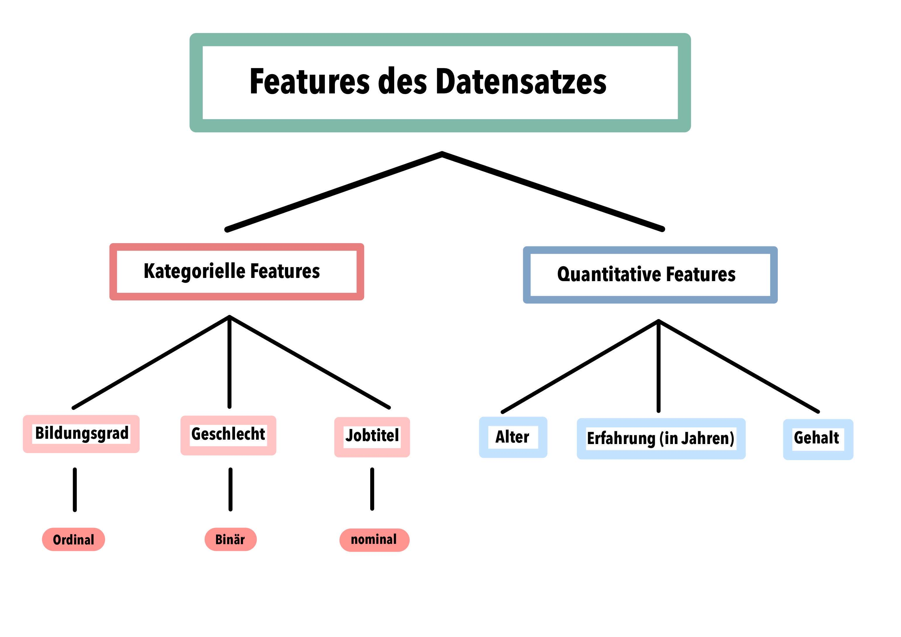

# Salary Prediction with Regression

My first machine learning project: predicting a person's salary from age, gender, education and years of experience, built as a team of four in the first semester. The notebook walks through the full workflow, from data cleaning to comparing two models.

| | |
|---|---|
| Course | Data Science I, B.Sc. Artificial Intelligence, Landshut University of Applied Sciences |
| Semester | 1st semester, winter 2024/25 |
| Team | Adam, Farouk, Dardan, Thies |
| Grade | 1.0 |
| Language | Notebook is written in German |

## Results

| Model | R² on the test set |
|---|---:|
| Linear regression | 0.881 |
| **K-nearest neighbours** (k = 5, chosen by grid search) | **0.900** |

Five-fold cross-validation of the linear regression gives R² between 0.83 and 0.93, so the result does not depend on one lucky split.

## What the project covers

- **Data cleaning:** missing values and 49 duplicates removed, leaving 324 rows; the job title was dropped because it has 174 different values
- **Exploration:** statistics, histograms and a correlation matrix
- **Feature types:** ordinal (education), binary (gender) and quantitative features, each handled differently



- **Preprocessing pipeline:** one-hot encoding for gender, ordinal encoding for education (Bachelor's < Master's < PhD), standard scaling for numbers
- **Models:** linear regression as baseline, then KNN with a grid search over k = 1 to 5

## Files

| File | Content |
|---|---|
| `salary_prediction.ipynb` | the full notebook with all outputs |
| `images/features.jpg` | our overview of the feature types |
| `requirements.txt` | Python packages |

## Run it yourself

1. Download the [Salary Prediction dataset](https://www.kaggle.com/datasets/rkiattisak/salaly-prediction-for-beginer) from Kaggle. The data is not included in this repository.
2. Save it next to the notebook as `salary.csv`.
3. Install the packages and start Jupyter:

```bash
pip install -r requirements.txt
jupyter notebook salary_prediction.ipynb
```

*Note: in the graded version, the two final `r2_score` calls had their arguments swapped. This version fixes the order, which changes the test scores slightly (from 0.877 and 0.897).*
